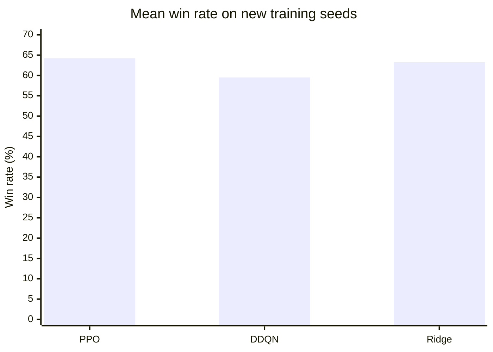
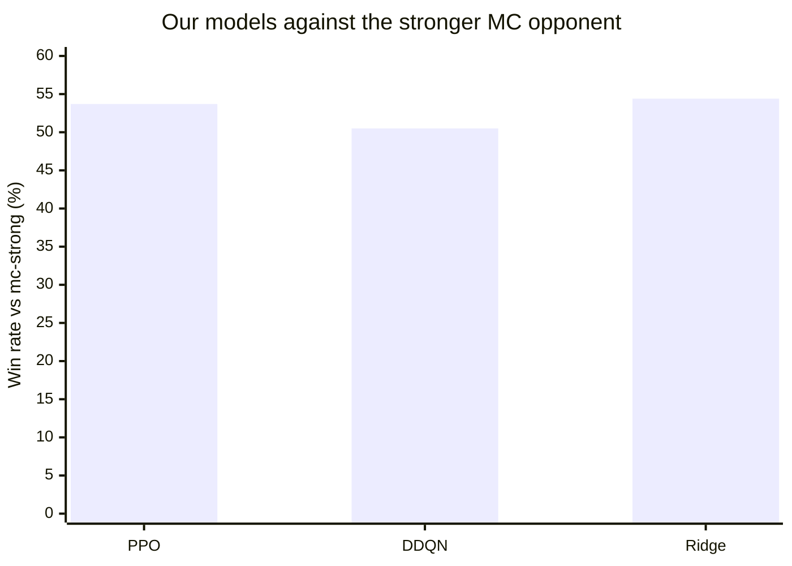
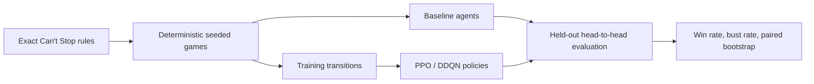

# Can't Stop — Learning Risk-Aware Game Strategy

> **Can reinforcement learning learn when to push forward—and when to stop—better than hand-designed rules?**

This project studies that question in *Can't Stop*, a board game whose central decision is a compact but difficult form of risk management: every additional roll can create progress, but can also erase the progress made during the current turn. We built and trained our own **Ridge**, **Double DQN (DDQN)**, and **PPO** agents, implemented a stronger **`mc-strong`** Monte Carlo opponent, and created a reproducible evaluation pipeline to compare them under identical dice, seats, and held-out games.

The project is important beyond one board game: it is a controlled testbed for sequential decision-making under uncertainty, where short-term reward, catastrophic failure, opponent behavior, and non-transitive policies interact.

## Headline result: our agents beat established strategies

Our models are not merely classifiers that imitate labels: they play complete games and are evaluated against traditional and published strategies. Across the evaluation suite, the trained agents consistently beat the classical Rule-of-28 baselines and the random policy; they also defeated several independently implemented or published opponents. On a common held-out evaluation of **3,000 games per matchup**, PPO led DDQN and Ridge against the primary opponents. The final two-seed retraining check showed that PPO and Ridge remained competitive while DDQN was more seed-sensitive.



These are means across two additional training seeds, evaluated on fresh games—not training accuracy. The full experiment record, caveats, and raw-artifact locations are documented in [`EXPERIMENT_STATUS.md`](cant_stop_baselines/docs/EXPERIMENT_STATUS.md).

## Why this problem matters

*Can't Stop* makes risk-sensitive control visible and measurable:

- **Progress versus ruin:** continuing can advance multiple columns, but a bust loses all unbanked turn progress.
- **Delayed consequences:** the best action depends on board position, opponent threats, and how close the player is to completing columns.
- **A meaningful baseline gap:** simple rules can be strong, so an ML model must demonstrate improvement in complete games—not merely fit labels.
- **A clean scientific setting:** the simulator gives us exact rules, deterministic seeds, controlled opponents, and repeatable ablations.

## Evidence from the final comparison

The promoted PPO-451 policy was evaluated against four external opponents using 3,000 games per matchup. The table reports each model's win rate; the minimum column is the score against its two primary opponents (`rule28-smart` and `mc`). These are complete-game results, not offline action accuracy.

| Model | Rule28-smart | MC | Glenn–Aloi | Couto-GA-stop | Minimum |
|---|---:|---:|---:|---:|---:|
| **PPO-451** | **64.1%** | **55.3%** | 80.9% | **65.8%** | **55.3%** |
| DDQN | 60.6% | 52.6% | 79.2% | 63.2% | 52.6% |
| Ridge | 59.1% | 52.1% | **81.7%** | 63.7% | 52.1% |
| Random Forest | 34.2% | 28.4% | 69.4% | 38.7% | 28.4% |

The `mc-strong` implementation was also used as a tougher Monte Carlo comparison. In a separate 3,000-game direct comparison, our models achieved **63.5% / 53.7% / 62.9%** against `rule28-smart` / `mc-strong` for PPO / DDQN / Ridge respectively; against `mc-strong`, Ridge reached **54.4%**, PPO **53.7%**, and DDQN **50.5%**. These results show both the strength of our agents and the fact that policy quality is opponent-dependent.

```mermaid
xychart-beta
    title "Primary held-out opponents"
    x-axis [Rule28-smart, MC]
    y-axis "Win rate (%)" 0 --> 70
    bar [64.1, 55.3]
    bar [60.6, 52.6]
    bar [59.1, 52.1]
    bar [34.2, 28.4]
```





The result is not a claim that one model wins every matchup or generalizes to every possible opponent. Policy rankings are opponent-dependent, and the evaluation protocol uses paired seat-swapped games. We therefore report paired comparisons and between-seed variability rather than treating all games as independent samples.

## What we built



- **Rules engine:** immutable agent-facing state, legal move generation, bust handling, banked progress, column closure, and terminal outcomes.
- **Agents:** random, Rule-of-28 variants, one-turn Monte Carlo, Glenn–Aloi, Couto, Ridge, DDQN, and PPO.
- **RL formulation:** the current controlled setup learns Stop/Continue decisions while keeping Glenn–Aloi dice pairing fixed, isolating the strategic decision under study.
- **Features:** raw board state plus domain features such as exact next-roll bust probability, at-risk progress, completion threats, and opponent lead.
- **Evaluation:** alternating seats, deterministic independent RNG streams, fresh seeds, raw per-game records, and paired bootstrap intervals.

## Negative results are part of the evidence

The project also tests ideas that did **not** work:

```mermaid
xychart-beta
    title "Learned pairing diagnostic: PPO-451 versus pairing-only model"
    x-axis [Rule28-smart, MC]
    y-axis "Win rate (%)" 0 --> 70
    bar [64.6, 55.4]
    bar [50.4, 44.5]
```



The learned-pairing diagnostic lost to the fixed-pairing PPO by 14.1 and 10.9 percentage points, respectively, with paired intervals excluding zero. This prevents us from presenting “more learned components” as automatically better and motivates the current fixed-pairing design.

## Quick start

The reference implementation requires Python 3.10+ and has no third-party dependency for the simulator:

```bash
cd cant_stop_baselines
python3 -m unittest discover -s tests -t . -v
cant-stop --agent-a rule28-smart --agent-b random --games 100 --seed 42
```

Install the package from the repository root with:

```bash
python3 -m pip install -e .
```

Optional ML/RL dependencies and reproducible training commands are documented in [`cant_stop_baselines/README.md`](cant_stop_baselines/README.md).

## Repository guide

| Path | Purpose |
|---|---|
| [`src/cant_stop/`](src/cant_stop/) | Reusable rules, state model, agents, RL environment, and evaluation API |
| [`cant_stop_baselines/scripts/`](cant_stop_baselines/scripts/) | Training, dataset, evaluation, and analysis entry points |
| [`cant_stop_baselines/tests/`](cant_stop_baselines/tests/) | Rule, transition, reproducibility, agent, and training tests |
| [`cant_stop_baselines/docs/EXPERIMENT_STATUS.md`](cant_stop_baselines/docs/EXPERIMENT_STATUS.md) | Source of truth for results and research decisions |
| [`final_report/report.pdf`](final_report/report.pdf) | Paper-style project report |
| [`spec.pdf`](spec.pdf) | Course specification; not the engine contract |

## Reproducibility and limitations

Every formal run records configuration, seeds, checkpoints, evaluation summaries, and raw game-level results under local `runs/` and `results/` directories. Before interpreting a result, read the experiment status document: it distinguishes promoted evidence, screening runs, negative results, and incomplete experiments.

Known limitations include two-player games only, fixed dice pairing in the promoted Stop/Continue study, no graphical interface, and no claim of full-game MCTS. The simulator-generated games and held-out evaluation protocol are described in the final report.

## References and citations

- **[1]** Martin Keller, [“Can't Stop? Try The Rule of 28”](https://www.solitairelaboratory.com/abstract/dicedominoes.html). Source of the traditional Rule-of-28 baseline.
- **[2]** James Glenn and Christian Aloi, [*A Generalized Heuristic for Can't Stop*](https://cdn.aaai.org/ocs/123/123-2430-1-PB.pdf), FLAIRS 2009. Source of the GA pairing weights and published heuristic comparison.
- **[3]** Leandro C. Medeiros, David S. Aleixo, and Levi H. S. Levis, [*What Can We Learn Even From the Weakest? Learning Sketches for Programmatic Strategies*](https://doi.org/10.1609/aaai.v36i7.20744), AAAI 2022. Source of the Couto/Sketch-SA(O) comparison agent.
- **[4]** J. Cameron Carter, *Using Machine Learning to Optimize the Board Game Can't Stop* (2026), user-provided thesis. Used as an additional implementation and feature reference; the adapter is explicitly labeled in this repository.
- **[5]** This project, [final report](final_report/report.pdf) and [experiment record](cant_stop_baselines/docs/EXPERIMENT_STATUS.md). Ridge, DDQN, PPO, and `mc-strong` are project implementations; their reported win rates come from this repository's seeded complete-game evaluations.

## License

MIT. See [`LICENSE`](LICENSE).
