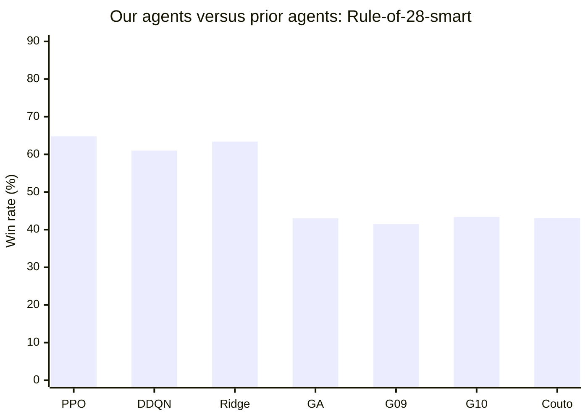
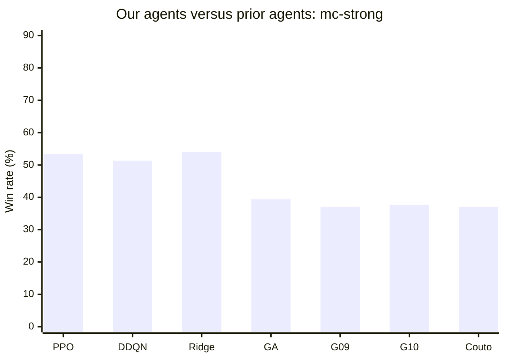
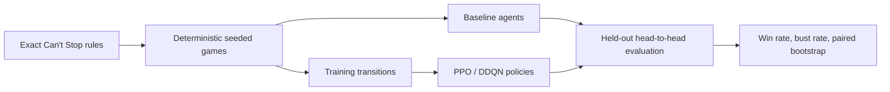

# Can't Stop — Learning Risk-Aware Game Strategy

> **Can reinforcement learning learn when to push forward—and when to stop—better than hand-designed rules?**

This project studies that question in *Can't Stop*, a board game whose central decision is a compact but difficult form of risk management: every additional roll can create progress, but can also erase the progress made during the current turn. We built and trained our own **Ridge**, **Double DQN (DDQN)**, and **PPO** agents, implemented a stronger **`mc-strong`** Monte Carlo opponent, and created a reproducible evaluation pipeline to compare them under identical dice, seats, and held-out games.

The project is important beyond one board game: it is a controlled testbed for sequential decision-making under uncertainty, where short-term reward, catastrophic failure, opponent behavior, and non-transitive policies interact.

## Headline result: our agents versus prior work

Our models are not merely classifiers that imitate labels: they play complete games against **traditional baselines and agents from previous work**. In a common direct comparison of **3,000 games per matchup**, our PPO, DDQN, and Ridge agents beat the published Glenn–Aloi, Glenn 2009, Glenn 2010, and Couto strategies in several matchups. The stronger `mc-strong` opponent also exposes a useful research result: it beats all four prior heuristic agents, while our learned agents remain competitive against it.

The final two-seed retraining check showed that PPO and Ridge remained competitive while DDQN was more seed-sensitive. These are fresh complete-game evaluations—not training accuracy. The full experiment record, caveats, and raw-artifact locations are documented in [`EXPERIMENT_STATUS.md`](cant_stop_baselines/docs/EXPERIMENT_STATUS.md).

The compact, report-ready evidence table and figures are in
[`docs/final_results/`](cant_stop_baselines/docs/final_results/). They separate
formal held-out results from descriptive sweeps and negative diagnostics.

## Why this problem matters

*Can't Stop* makes risk-sensitive control visible and measurable:

- **Progress versus ruin:** continuing can advance multiple columns, but a bust loses all unbanked turn progress.
- **Delayed consequences:** the best action depends on board position, opponent threats, and how close the player is to completing columns.
- **A meaningful baseline gap:** simple rules can be strong, so an ML model must demonstrate improvement in complete games—not merely fit labels.
- **A clean scientific setting:** the simulator gives us exact rules, deterministic seeds, controlled opponents, and repeatable ablations.

## Evidence: our agents versus published agents

The post-merge direct comparison used **3,000 games per matchup**, alternating seats and 64 Monte Carlo rollouts where applicable. It used PPO seed 460, DDQN seed 448, and Ridge seed 642; “win rate” means the row agent's win rate against the column opponent. Raw records are archived under [`docs/experiments/post_merge_20261103`](cant_stop_baselines/docs/experiments/post_merge_20261103).

| Our agent | vs Rule-of-28-smart | vs `mc-strong` | vs Glenn–Aloi | vs Glenn 2009 | vs Glenn 2010 | vs Couto |
|---|---:|---:|---:|---:|---:|---:|
| **PPO** | **64.8%** | 53.4% | **68.1%** | **69.2%** | **66.4%** | 67.6% |
| **DDQN** | 61.0% | 51.3% | 64.1% | 64.8% | 60.3% | 66.1% |
| **Ridge** | 63.4% | **54.0%** | 66.9% | 68.0% | 65.7% | **68.3%** |

For the reverse comparison, the prior agents' own win rates were much lower:

| Prior agent | vs `rule28-smart` | vs `mc-strong` | vs Random |
|---|---:|---:|---:|
| Glenn–Aloi [2] | 43.0% | 39.4% | 95.6% |
| Glenn 2009 Constant [2] | 41.5% | 37.1% | 95.3% |
| Glenn 2010 Linear [2] | 43.4% | 37.7% | 97.5% |
| Couto / Sketch-SA(O) [3] | 43.1% | 37.1% | 95.3% |
| Carter adapted checkpoint [4] | — | — | 25.0% |
| vmerckle flat Monte Carlo [6] | 2.8% | 2.6% | 70.9% |
| vmerckle root-only UCB1 [6] | 4.5% | 3.7% | 77.4% |

The `mc-strong` implementation therefore beats all four prior heuristic agents in this direct comparison, while our PPO, DDQN, and Ridge policies remain competitive against it. These values replace the pre-merge matrix; the prior implementation used different paper-policy behavior.

\* Carter is the public `dqn_multi_opp.keras` checkpoint from [J. Cameron
Carter's repository](https://github.com/JCameronCarter/HonorsThesis), evaluated
as a checkpoint and feature/simulator adaptation. The canonical archived
calibration is 644/3,000 (21.47%) against Random; it uses an equivalent
`51 -> 64 -> 64 -> 2` inference network, Carter's action convention and
heuristic dice-pair selector, with no retraining. It is not a result from
Carter's original environment.

These results show the main contribution clearly: our agents improve on the traditional baseline and defeat several previous agents, while no single policy dominates every opponent. The ranking is opponent-dependent, which is why we report a matrix rather than one cherry-picked score.





The archived post-merge run also includes paired-bootstrap intervals; the table shows point estimates for readability, not claims that every difference is significant. Policy rankings are opponent-dependent, and the evaluation protocol uses paired seat-swapped games; we do not treat all games as independent samples.

## What we built



- **Rules engine:** immutable agent-facing state, legal move generation, bust handling, banked progress, column closure, and terminal outcomes.
- **Agents:** random, Rule-of-28 variants, one-turn Monte Carlo, Glenn–Aloi, Couto, Carter's adapted public checkpoint, Ridge, DDQN, and PPO.
- **RL formulation:** the current controlled setup learns Stop/Continue decisions while keeping Glenn–Aloi dice pairing fixed, isolating the strategic decision under study.
- **Features:** raw board state plus domain features such as exact next-roll bust probability, at-risk progress, completion threats, and opponent lead.
- **Evaluation:** alternating seats, deterministic independent RNG streams, fresh seeds, raw per-game records, and paired bootstrap intervals.

## Negative results are part of the evidence

The project also tests ideas that did **not** work:

```mermaid
xychart-beta
    title "Learned pairing diagnostic: PPO-451 versus pairing-only model"
    x-axis [Rule28-smart, MC]
    y-axis "Win rate (%)" 0 --> 70
    bar [64.6, 55.4]
    bar [50.4, 44.5]
```



The learned-pairing diagnostic lost to the fixed-pairing PPO by 14.1 and 10.9 percentage points, respectively, with paired intervals excluding zero. This prevents us from presenting “more learned components” as automatically better and motivates the current fixed-pairing design.

## Quick start

The reference implementation requires Python 3.10+ and has no third-party dependency for the simulator:

```bash
cd cant_stop_baselines
python3 -m unittest discover -s tests -t . -v
cant-stop --agent-a rule28-smart --agent-b random --games 100 --seed 42
```

Install the package from the repository root with:

```bash
python3 -m pip install -e .
```

Optional ML/RL dependencies and reproducible training commands are documented in [`cant_stop_baselines/README.md`](cant_stop_baselines/README.md).

## Repository guide

| Path | Purpose |
|---|---|
| [`src/cant_stop/`](src/cant_stop/) | Reusable rules, state model, agents, RL environment, and evaluation API |
| [`cant_stop_baselines/scripts/`](cant_stop_baselines/scripts/) | Training, dataset, evaluation, and analysis entry points |
| [`cant_stop_baselines/tests/`](cant_stop_baselines/tests/) | Rule, transition, reproducibility, agent, and training tests |
| [`cant_stop_baselines/docs/EXPERIMENT_STATUS.md`](cant_stop_baselines/docs/EXPERIMENT_STATUS.md) | Source of truth for results and research decisions |
| [`spec.pdf`](spec.pdf) | Course specification; not the engine contract |

## Reproducibility and limitations

Every formal run records configuration, seeds, checkpoints, evaluation summaries, and raw game-level results under local `runs/` and `results/` directories. Before interpreting a result, read the experiment status document: it distinguishes promoted evidence, screening runs, negative results, and incomplete experiments.

Known limitations include two-player games only, fixed dice pairing in the promoted Stop/Continue study, no graphical interface, and no claim of full-game MCTS. The simulator-generated games and held-out evaluation protocol are described in the experiment documentation.

## References and citations

- **[1]** Martin Keller, [“Can't Stop? Try The Rule of 28”](https://www.solitairelaboratory.com/abstract/dicedominoes.html). Source of the traditional Rule-of-28 baseline.
- **[2]** James Glenn and Christian Aloi, [*A Generalized Heuristic for Can't Stop*](https://cdn.aaai.org/ocs/123/123-2430-1-PB.pdf), FLAIRS 2009. Source of the GA pairing weights and published heuristic comparison.
- **[3]** Leandro C. Medeiros, David S. Aleixo, and Levi H. S. Lelis, [*What Can We Learn Even From the Weakest? Learning Sketches for Programmatic Strategies*](https://doi.org/10.1609/aaai.v36i7.20744), AAAI 2022. Source of the Couto/Sketch-SA(O) comparison agent.
- **[4]** J. Cameron Carter, *Using Machine Learning to Optimize the Board Game Can't Stop* (2026), user-provided thesis. Used as an additional implementation and feature reference; the adapter is explicitly labeled in this repository.
- **[5]** This project, [experiment record](cant_stop_baselines/docs/EXPERIMENT_STATUS.md). Ridge, DDQN, PPO, and `mc-strong` are project implementations; their reported win rates come from this repository's seeded complete-game evaluations.
- **[6]** vmerckle/CantStop-AI, inspected commit `25be22910e3bfc5c351f38ff5461602d95dacd0a`; these are clean-room behavioral ports. The UCB1 variant is root-only, not full-tree MCTS. See the [vmerckle experiment record](cant_stop_baselines/docs/experiments/vmerckle_20261028/) and [prior-work audit](cant_stop_baselines/docs/PRIOR_WORK_AUDIT.md).

## License

MIT. See [`LICENSE`](LICENSE).
