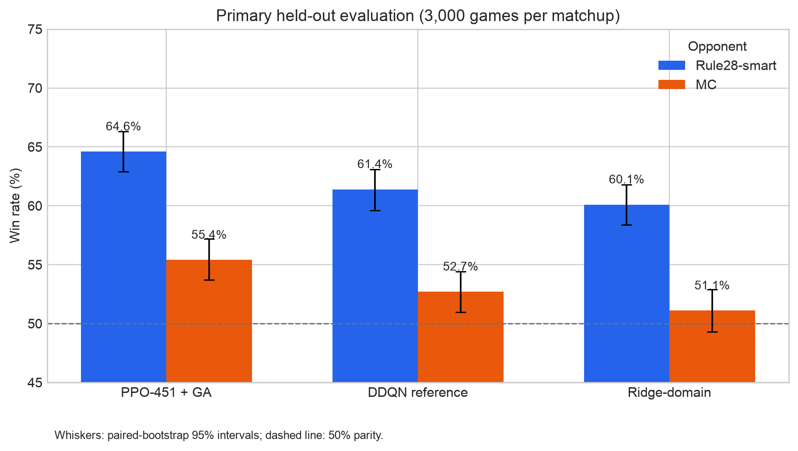
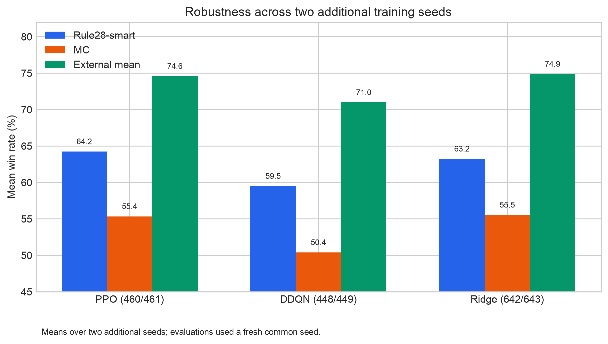
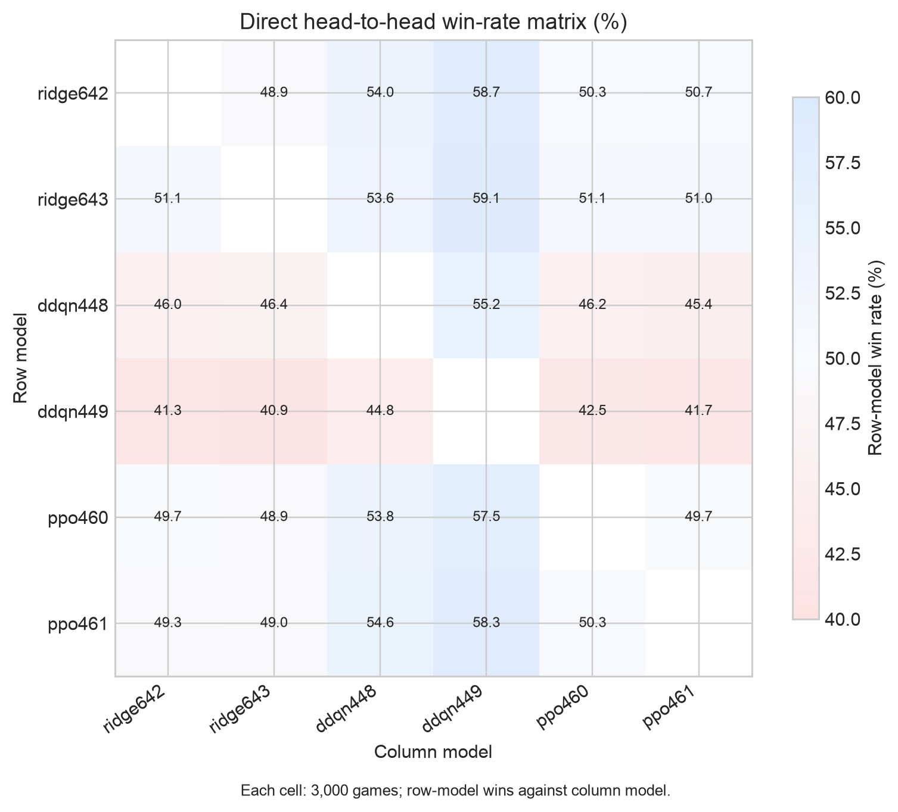
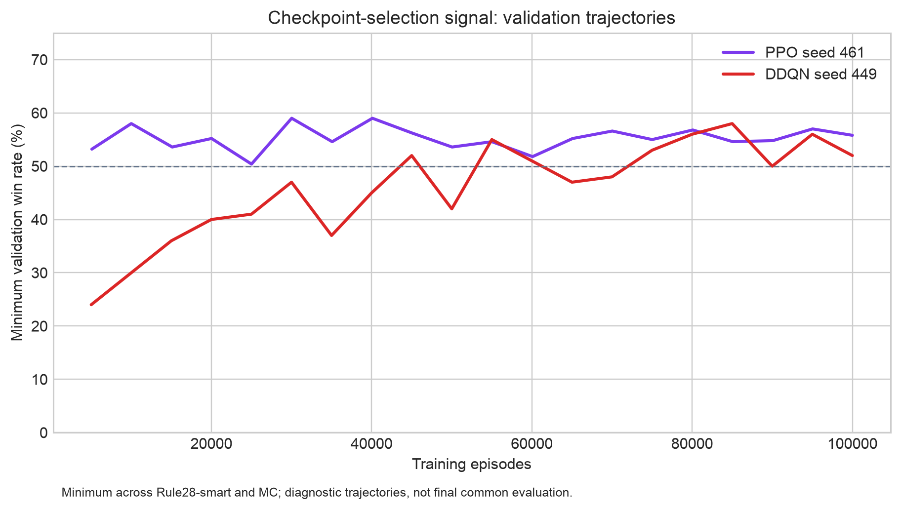

# Learning Stop/Continue Strategies in *Can't Stop*

**CS 441 Final Project — Fall 2026**  
**Group members:** *[add names and net IDs]*  
**Code:** [repository link to be added]  
**Data and experiment artifacts:** [repository link to be added; see `cant_stop_baselines/runs/`]  
**Video:** *[add 5–6 minute video link]*

## Abstract

We study whether machine learning can improve the strategic Stop/Continue
decision in the two-player board game *Can't Stop*. The application observes a
game state after a successful roll and chooses either to bank the temporary
progress or risk another roll. We compare a rule-based baseline, a supervised
linear model, Double DQN, and PPO. Dice-pair selection is held fixed to the
Glenn–Aloi constant-weight policy for the main comparison, so the experiment
isolates the Stop/Continue policy.

The strongest retained model is a PPO policy trained from scratch with domain
features and a 60% Monte Carlo / 40% smart Rule-of-28 opponent mixture. On a
fresh common evaluation set of 3,000 games per matchup, it won 64.6% against
Rule28-smart and 55.4% against the approximate MC agent. It significantly
outperformed the retained DDQN reference by 3.2 percentage points and 2.7
points, respectively, under paired bootstrap intervals. Two additional seeds
support the PPO result: PPO averaged 64.25% against Rule28-smart and 55.35%
against MC, compared with 59.50% and 50.40% for DDQN. However, PPO and the
multi-policy Ridge model were close in direct head-to-head games, so we do not
claim universal superiority. Learned dice pairing and several fine-tuning and
supervised-DNN variants were negative results.

## 1. Problem Description and Motivation

### 1.1 Application

The proof-of-concept application is an automated *Can't Stop* player. Given the
board position, temporary runners, banked progress, the opponent's progress,
and the result of the current dice pairing, the player decides whether to:

* **Continue:** roll again and potentially gain more progress or bust; or
* **Stop:** bank the current temporary progress and pass the turn.

The game is a useful decision-making problem because every decision trades off
short-term risk against progress toward claiming three columns. A simple
heuristic can be reasonable, but the value of continuing depends on the whole
board, opponent threats, completed columns, and the probability of busting.

### 1.2 Intended user and use case

The intended user is a person playing or studying *Can't Stop*. The application
can act as an opponent, provide a recommendation during a human game, or serve
as an educational tool that explains why a state is risky. The practical
benefit is a reproducible strategy assistant rather than a claim that the game
has one universally optimal move.

### 1.3 ML formulation

This is a two-action sequential decision problem. At each eligible decision
state, the input is a fixed-length vector describing the current player's
state. The output is a policy over `{Continue, Stop}`. The principal reward is
terminal: `+1` for a win, `-1` for a loss, and `0` otherwise. The main PPO and
DDQN experiments use fixed GA dice pairing, while the learned-pairing
experiments additionally predict a legal pairing action.

The game engine is independent of the policies. It enforces the standard
board heights `(3,5,7,9,11,13,11,9,7,5,3)`, at most three active columns,
temporary progress loss on a bust, and victory after three claimed columns.
The implementation was checked by a regression suite and seeded
reproducibility tests.

## 2. ML Approach

### 2.1 Baselines

We used several increasingly strong baselines:

1. **Rule28-smart:** a transparent heuristic based on Rule of 28 and
   Glenn–Aloi constant move weights. It stops at a score threshold or when a
   temporary runner reaches a column top.
2. **Approximate MC:** fixed GA pairing plus one-turn Monte Carlo rollouts,
   with Rule28-smart used after simulated actions. It is an approximate
   remainder-of-turn policy, not full-game MCTS.
3. **Ridge-domain:** a supervised Ridge regressor predicting the approximate
   margin `Q(Continue) - Q(Stop)` from domain features. It continues when the
   predicted margin is positive.
4. **MC-counterfactual DDQN:** the retained RL reference, trained with
   Double DQN, five-step returns, domain features, and counterfactual MC
   supervision.

The final report focuses on PPO, DDQN, and Ridge because Random Forest and the
single-source and multi-policy DNNs were clearly weaker in complete-game
evaluation.

### 2.2 PPO model

The promoted PPO policy uses a 68-value domain observation and a 128x128 MLP.
It was trained for 100,000 episodes with terminal-only reward, 512-step
rollouts, four PPO epochs, minibatches of 256, learning rate `1e-4`, and fixed
GA pairing. The training opponent mixture was 60% MC and 40% Rule28-smart.
Training MC used 16 rollouts and a future-roll limit of 20; held-out evaluation
used MC-64. The promoted checkpoint is the best validation checkpoint from
seed 451, episode 95,021:

`cant_stop_baselines/runs/ppo_mc_focused_seed451/top_1.pt`

Checkpoint selection maximized the minimum validation win rate across the two
primary opponents. We retained the checkpoint rather than the final training
weights because validation performance oscillated substantially during PPO
training.

### 2.3 DDQN model

The DDQN reference uses a 128x128 network, 68 domain features, five-step
returns, fixed GA pairing, terminal game rewards, and an opponent mixture of
Rule28-smart, MC, pure GA Rule 28, classic Rule 28, and random agents. The
retained checkpoint is:

`cant_stop_baselines/runs/ddqn_mc_counterfactual_seed447/best.pt`

This model is the main RL baseline because it was selected before the final
PPO comparison and remained more reliable than attempted self-play and
fine-tuning variants.

### 2.4 Supervised Ridge model

We collected 10,000 decision states from simulator-generated games. For each
state, the pipeline forced Stop and Continue using shared future random seeds
and estimated each action's full-game win probability with paired rollouts.
The target was the resulting action margin. A grouped 70/15/15 split by source
game prevented states from the same game appearing in multiple splits. The
multi-policy Ridge model was trained on states drawn from five policies
(Rule28-smart, MC, Ridge, PPO, and DDQN), using the same counterfactual label
procedure. This distribution improved Ridge robustness over the original
single-policy dataset.

## 3. Data Collection and Curation

All data were generated by our own simulator rather than taken from Kaggle,
benchmark datasets, or a pre-curated ML dataset. Each generated game records
the seed, seat assignment, winner, turns, rolls, busts, and stops. Decision
states are stored with fixed-length features and metadata identifying the
source game and policy.

The state representation contains 58 raw values. The domain representation
contains 68 values, including active/top marker counts, immediate completion
and win indicators, board-progress lead, risk-adjusted turn progress,
normalized Rule-of-28 score, and opponent threat. The strategic ablation adds
per-column temporary progress and completion-threat features.

For supervised labels, the same state and future random seeds were used for
the forced Stop and forced Continue branches. This reduces label noise caused
by unrelated dice variation. Labels remain approximate because the rollout
policy after the forced action is Rule28-smart; they are not optimal-game
ground truth. Source games, rather than individual states, were split before
training. Evaluation games were generated with fresh seeds that were not used
for collection, training, or checkpoint selection.

For every formal model comparison, seats were alternated. The two games in a
seat-swapped pair share a dice seed, so paired bootstrap is more appropriate
than treating all game outcomes as independent. We report 5,000 paired
bootstrap samples and interpret intervals as descriptive paired inference.

## 4. Experimental Design

### 4.1 Primary evaluation

The final common evaluation used seed `1000454`, 3,000 games per matchup,
alternating seats, MC-64, and 5,000 paired-bootstrap samples. All models faced
the same fresh dice seeds and the same two primary opponents.

### 4.2 Primary results

| Model | Rule28-smart | MC | Minimum |
|---|---:|---:|---:|
| **PPO-451 + GA** | **64.6%** | **55.4%** | **55.4%** |
| DDQN reference | 61.4% | 52.7% | 52.7% |
| Ridge-domain | 60.1% | 51.1% | 51.1% |



**Figure 1.** PPO has the highest point estimate against both primary
opponents, and its paired intervals are above the DDQN and Ridge comparisons
reported below.

PPO's paired advantage over DDQN was **+3.2 points** against Rule28-smart,
with a 95% interval of **+1.2 to +5.3**, and **+2.7 points** against MC,
with an interval of **+0.6 to +5.0**. PPO's advantage over Ridge was +4.5
points against Rule28-smart (interval +2.2 to +6.7) and +4.3 points against
MC (interval +1.9 to +6.6). DDQN versus Ridge was not statistically resolved.

The primary PPO results were not merely wins against weak opponents. In a
separate 3,000-game external-opponent evaluation, PPO won 80.9% against the
released Glenn–Aloi agent and 65.8% against the Couto-GA-stop adaptation. The
corresponding PPO rates against Rule28-smart and MC were 64.1% and 55.3%.
These results also show opponent dependence: Ridge slightly exceeded PPO
against Glenn–Aloi (81.7% versus 80.9%) in that evaluation.

### 4.3 Additional-seed robustness

We retrained each retained family with two additional seeds and evaluated on a
common fresh set of 3,000 games per matchup (seed `20261101`). The values below
are means over the two new training seeds, not pooled games and not a claim
that every future seed will match them.

| Model family | Rule28-smart mean | MC mean | External-opponent mean | Minimum mean |
|---|---:|---:|---:|---:|
| PPO (seeds 460/461) | **64.25%** | 55.35% | 74.6% | 55.35% |
| DDQN (seeds 448/449) | 59.50% | 50.40% | 71.0% | 50.40% |
| Ridge (seeds 642/643) | 63.25% | **55.55%** | **74.9%** | **55.55%** |



**Figure 2.** The additional-seed check shows that PPO and Ridge are close,
while DDQN has the lowest mean and greater seed sensitivity.

PPO was consistent across the two additional seeds. DDQN was more seed
sensitive, while Ridge was also stable and close to PPO. Thus the evidence
supports PPO as the strongest promoted RL policy, but not as a uniformly
dominant policy family.

### 4.4 Direct head-to-head results

The six additional checkpoints were also compared directly in 3,000-game
pairings using seed `20261102`. Averaging the two cross-family results gives:

| Pair | Approximate first-model win rate |
|---|---:|
| PPO versus DDQN | 56.1% |
| PPO versus Ridge | 49.2% |
| Ridge versus DDQN | 56.3% |

The direct results qualify the primary-opponent conclusion. Performance is
non-transitive and depends on the opponent; PPO is clearly strong against the
selected external baselines, but the new Ridge checkpoints were competitive
and slightly favored in direct games.



**Figure 3.** Rows are the models whose wins are counted; columns are their
opponents. The matrix makes the non-transitive relationship visible instead
of reducing it to one overall ranking.

### 4.5 Ablations and negative results

Negative results were retained as part of the model-selection evidence:

* A learned-pairing PPO run destroyed performance when all parameters were
  updated. A pairing-only diagnostic preserved the Stop/Continue policy but
  still scored only 50.4% versus Rule28-smart and 44.5% versus MC, below PPO
  (64.6% and 55.4%) and DDQN (61.4% and 52.8%).
* A supervised DNN trained on the original counterfactual dataset scored
  42.7% and 36.2% against Rule28-smart and MC, despite 68.2% validation action
  accuracy. The multi-policy DNN was weaker still at 32.3% and 28.7%.
* Multi-policy Ridge improved over the original Ridge (62.7%/57.4% versus
  59.4%/53.2% in its comparison), showing that state-distribution curation
  helped the linear model but did not make the DNN effective.
* Self-play, conservative fine-tuning, targeted fine-tuning, reference-replay
  fine-tuning, and a counterfactual PPO screen all regressed on held-out
  games. For example, the reference-replay DDQN fell to 58.6%/50.4%/46.7%
  against Rule28-smart/MC/Ridge.

These ablations prevent us from attributing all improvement to neural-network
capacity or to additional training alone.



**Figure 4.** Validation performance is noisy and checkpoint-sensitive. This
is why the final selection used a held-out common evaluation rather than the
last training checkpoint.

## 5. Discussion

The answer to our research question is **qualified yes**. PPO learned a
stronger Stop/Continue policy than the retained DDQN and Ridge baselines when
tested against the primary heuristic and approximate MC opponents. The
advantage was statistically supported in the paired common evaluation and was
largely reproduced by two additional PPO training seeds.

The answer is not “PPO always wins.” First, direct head-to-head results are
near 50–50 against Ridge and show non-transitive strategy interactions.
Second, the paired intervals are based on shared dice-seed pairs and should
not be interpreted as independent-game confidence intervals. Third, training
and evaluation use simulator-generated games, so the conclusions concern this
implementation of two-player *Can't Stop*, fixed GA pairing, and the selected
opponent distribution.

The most useful engineering result is that selecting a stable checkpoint and
curating state distributions mattered more than adding model complexity.
Learned pairing was unsuccessful under the current terminal-reward setup,
while multi-policy data improved Ridge. The final application should therefore
ship PPO-451 + GA as the primary player, keep DDQN as an RL reference, and
offer Ridge as a lightweight alternative.

## 6. Limitations and Future Work

1. The main study uses two players and fixed GA dice pairing; a learned joint
   pairing policy was tested but not solved.
2. MC is an approximate one-turn rollout agent, not full-game MCTS or an
   optimal oracle.
3. The supervised labels are approximate Rule28-smart rollouts, so offline
   accuracy is not a substitute for complete-game evaluation.
4. PPO and Ridge have only two additional retraining seeds in the final
   robustness check. More independent seeds would strengthen generalization
   claims.
5. The current proof of concept has no graphical interface and does not claim
   support for three- or four-player variants.

Future work should investigate legal-action-masked pairing with a better
training objective, broader independent-seed evaluation, and calibrated
explanations of the predicted risk of continuing.

## 7. Reproducibility

The source tree contains the simulator, agents, training scripts, tests, model
checkpoints, raw per-game CSV files, JSON summaries, and configuration files.
The most important artifacts are:

* `cant_stop_baselines/docs/EXPERIMENT_STATUS.md` — experiment log and final
  decisions;
* `cant_stop_baselines/runs/final_common_eval_seed1000454/` — primary common
  evaluation and raw games;
* `cant_stop_baselines/runs/final_retrain_head_to_head_seed20261102/` —
  additional-seed direct comparisons;
* `cant_stop_baselines/runs/ppo_mc_focused_seed451/top_1.pt` — promoted PPO;
* `cant_stop_baselines/runs/ddqn_mc_counterfactual_seed447/best.pt` — DDQN
  reference;
* `cant_stop_baselines/runs/ridge_multi_policy_seed642/` and `seed643/` —
  additional Ridge models.

From `cant_stop_baselines/`, the regression suite can be run with:

```bash
python3 -m unittest discover -s tests -t . -v
```

## 8. Acknowledgements and Contributions

We acknowledge the authors of the Rule of 28, Glenn–Aloi heuristic, and
Couto/Sketch-SA(O) work cited below. Their methods are used as documented
baselines or adaptations; they are not presented as our original algorithms.

**Contributions:** *[replace this paragraph with each member's concrete work,
for example simulator/rules, data pipeline, PPO/DDQN training, evaluation,
analysis, and report/video preparation.]*

## References

1. Martin Keller. “Can't Stop? Try The Rule of 28.” 1986.
2. James Glenn and Christian Aloi. “A Generalized Heuristic for Can't Stop.”
   FLAIRS, 2009. https://cdn.aaai.org/ocs/123/123-2430-1-PB.pdf
3. Leandro C. Medeiros, David S. Aleixo, and Levi H. S. Levis. “What Can We
   Learn Even From the Weakest? Learning Sketches for Programmatic
   Strategies.” AAAI, 2022. https://doi.org/10.1609/aaai.v36i7.20744
4. J. Cameron Carter. “Using Machine Learning to Optimize the Board Game
   Can't Stop.” 2026, user-provided thesis.
